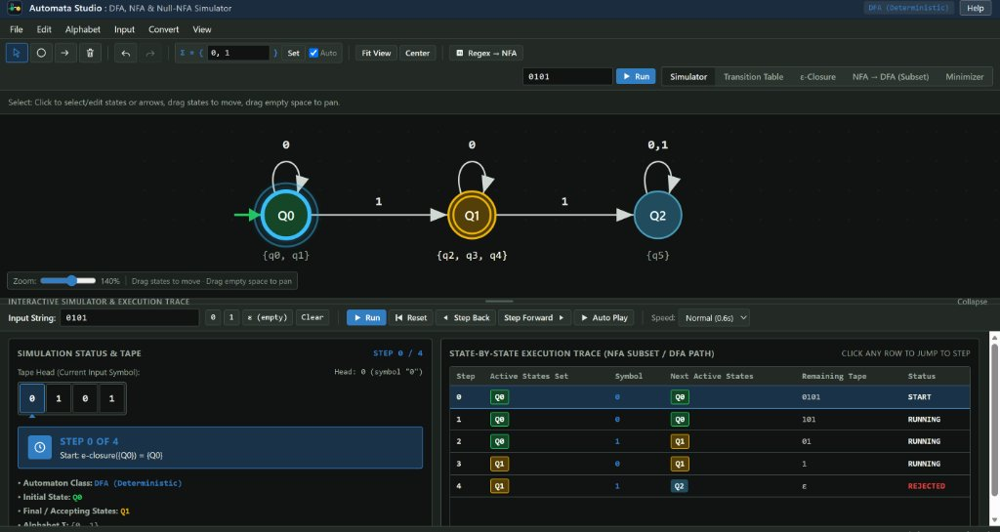
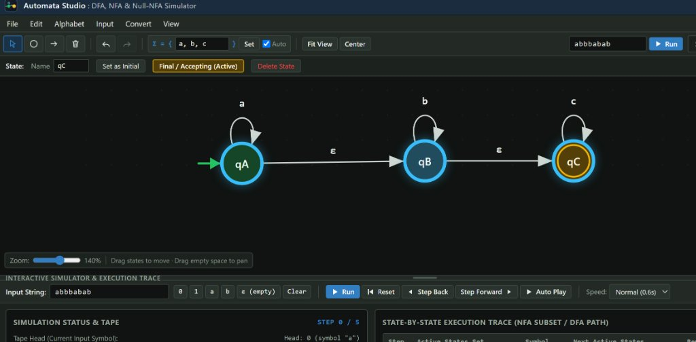
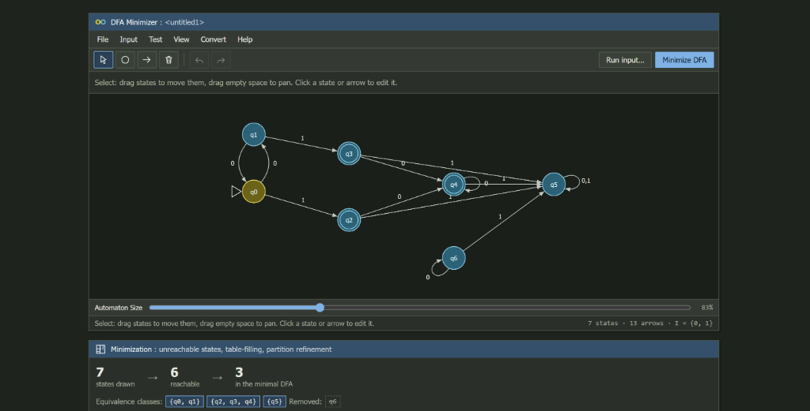
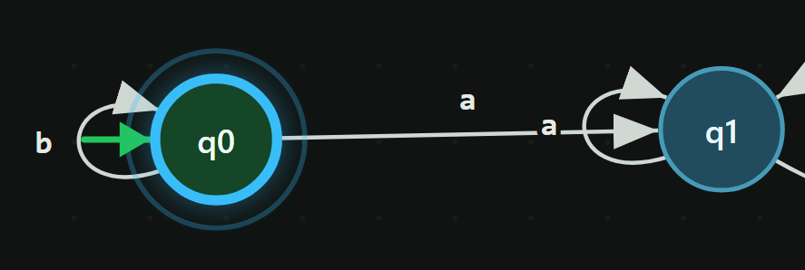
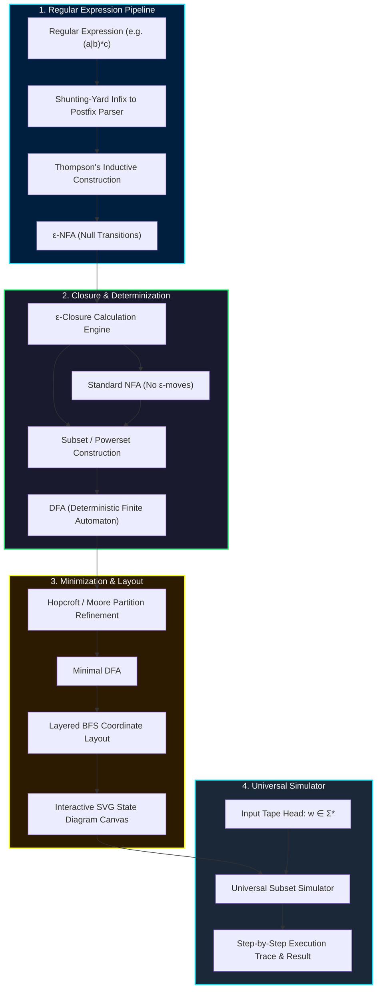

<div align="center">

# ♾️ Automata Studio
### Interactive DFA, NFA & Null-NFA ($\varepsilon$-NFA) Simulator & Visualizer

[](https://dev-maegor.github.io/Automata-Simulator/)
[](LICENSE)
[](#)
[](#)
[-00e5ff?style=for-the-badge)](#)

<p align="center">
  <b>A comprehensive, textbook-grade web application for designing, simulating, and transforming Finite State Automata.</b><br>
  Supports Deterministic (DFA), Nondeterministic (NFA), and Null-Transition ($\varepsilon$-NFA) machines with step-by-step trace execution, Thompson's regex construction, powerset subset construction, and Hopcroft minimization.
</p>

[**Explore Live Demo »**](https://dev-maegor.github.io/Automata-Simulator/)

---

</div>

## 📸 Showcase & Visual Walkthrough

### 1. Interactive Canvas & Execution Simulator
> Draw states, connect transitions with custom symbols ($\Sigma$ or $\varepsilon$), and watch the tape head step through input strings with complete state-by-state trace logging.

<div align="center">
  
</div>

<br>

### 2. Null-NFA ($\varepsilon$-Transitions) & Dynamic Alphabet
> Full support for empty-string ($\varepsilon$ / $\lambda$) moves, live tape tracking, and automatic alphabet auto-detection from diagram transitions.

<div align="center">
  
</div>

<br>

### 3. Formal DFA State Minimization Benchmark
> Table-filling (Moore) and partition refinement (Hopcroft) discover equivalent state classes and generate minimal DFAs with a single click.

<div align="center">
  
</div>

<br>

### 4. High-Contrast Vector Styling
> Clean UI free of emoji clutter. Initial states glow with directed emerald green arrows; accepting states feature concentric golden rings; self-loops automatically orient away from straight lines.

<div align="center">
  
</div>

---

## ⚡ Key Capabilities

### 🎨 Visual State Diagram Canvas
* **Direct Manipulation**: Click-and-drag states with continuous coordinate clamping, magnetic grid snapping, and freeform canvas panning & zooming ($30\% - 250\%$).
* **Distinct State Indicators**:
  * 🟢 **Initial State**: Single designated start state adorned with a high-contrast emerald green entry vector arrow.
  * 🟡 **Final / Accepting States**: Double concentric circular rings rendered in crisp golden yellow.
* **Smart Arrow Curves & Self-Loops**: Bidirectional transitions automatically compute bezier curves to avoid overlap, and self-loop arcs can be reoriented to any 90° angle.

### 🧵 Universal Step-by-Step Simulation Engine
* **Multimodal Execution**: Universally simulates **DFA**, **NFA**, and **$\varepsilon$-NFA** through recursive $\varepsilon$-closure and powerset state set tracking.
* **Interactive Tape Head**: Visual strip illustrating the input string symbol-by-symbol, tracking the active reading head position.
* **Comprehensive Execution Trace**: Step index, active state subsets, input symbol consumed, next active states, remaining unconsumed tape, and live status (`START`, `RUNNING`, `ACCEPTED`, `REJECTED`).
* **Playback Controls**: Step Forward, Step Back, Run to End, Reset, and Auto-Play with adjustable playback speed ($0.25\text{s} - 1.2\text{s}$).
* **Resizable Splitter**: Draggable partition between tape status and trace table with double-click reset and persistent layout memory.

### 🔨 Build from Regular Expressions
* **Thompson's Inductive Construction**: Converts arbitrary infix regular expressions into equivalent automata with automatic precedence parsing:
  * Concatenation (`·` or implicit `ab`)
  * Alternation / Union (`|`)
  * Kleene Star (`*`), Plus (`+`), Optional (`?`)
  * Grouping parentheses (`( )`)
* **Flexible Target Compilation**:
  * **$\varepsilon$-NFA**: Standard textbook Thompson $\varepsilon$-moves.
  * **NFA**: Direct non-deterministic automaton with all $\varepsilon$-transitions eliminated via reachability closure.
  * **DFA**: Deterministic machine generated via subset construction.
  * **Minimal DFA**: Reduced minimal state machine via Hopcroft equivalence classes.

### 🔄 Conversion & Equivalence Tools
* **NFA to DFA Subset Construction**: Complete powerset transition matrix $\delta_D(S, a) = \varepsilon\text{-closure}(\delta(S, a))$. Allows 1-click replacement of the canvas with the converted DFA.
* **$\varepsilon$-Closure Calculation**: Complete analytical table displaying $\varepsilon\text{-closure}(q)$ for every state, reachability paths, and an interactive subset calculator.
* **DFA State Minimization**: Eliminates unreachable states, computes 0-equivalence and $k$-equivalence partition refinement, and displays pairwise table-filling matrices.
* **Transition Matrix**: Real-time matrix view of $\delta(q, a)$ across all states and symbols in $\Sigma$.

### 📚 Pre-Generated Textbook Benchmark Library
Quick-load classic machines from the **File** menu:
* **DFA 7-State Benchmark**: Classic minimization test case.
* **Binary Ending in '01'**: Minimal pattern matching automaton.
* **Parity Automaton**: Even number of 0s and even number of 1s.
* **Binary Divisible by 3**: Modulo-3 remainder tracker.
* **Substring 'aba'**: Sequential search DFA.
* **NFA Ending in '01'**: Non-deterministic branch racer.
* **Null-NFA $(0 \mid 1)^* 01$**: Multiple $\varepsilon$-transitions and loopbacks.
* **Null-NFA $a^* b^* c^*$**: Epsilon cascaded language generator.

---

## 📐 Theoretical Architecture & Mathematical Pipeline

Automata Studio integrates textbook formal automata theory into a responsive client pipeline:



### Mathematical Definitions

An automaton is formally modeled as a 5-tuple:
$$M = (Q, \Sigma, \delta, q_0, F)$$

Where:
- $Q$ is the finite set of states.
- $\Sigma$ is the finite input alphabet (excluding the empty symbol $\varepsilon$).
- $\delta: Q \times (\Sigma \cup \{\varepsilon\}) \to 2^Q$ is the transition function.
- $q_0 \in Q$ is the designated start/initial state.
- $F \subseteq Q$ is the set of final/accepting states.

The $\varepsilon$-closure of a state subset $S \subseteq Q$ is defined as the smallest set such that:
$$S \subseteq \varepsilon\text{-closure}(S)$$
$$q \in \varepsilon\text{-closure}(S) \land p \in \delta(q, \varepsilon) \implies p \in \varepsilon\text{-closure}(S)$$

---

## 🚀 Quick Start & Local Usage

Automata Studio is built as a single, fully-contained web application. It requires **no node modules, no bundlers, and no compilation**:

### Option 1: Live Web App (Instant)
Visit the live hosted version directly:
👉 **[https://dev-maegor.github.io/Automata-Simulator/](https://dev-maegor.github.io/Automata-Simulator/)**

### Option 2: Run Locally
1. Clone the repository:
   ```bash
   git clone https://github.com/dev-maegor/Automata-Simulator.git
   cd Automata-Simulator
   ```
2. Open `index.html` (or `main.html`) directly in your favorite browser:
   * **Windows**: Double-click `index.html` or run `start index.html`
   * **macOS**: `open index.html`
   * **Linux**: `xdg-open index.html`

---

## ⌨️ Keyboard Shortcuts

| Shortcut | Action | Description |
| :--- | :--- | :--- |
| `V` | **Select Tool** | Click states or edges to edit properties; drag to pan canvas |
| `S` | **State Tool** | Click anywhere on canvas to create a new state |
| `T` | **Transition Tool** | Click state $A$ then state $B$ to create or edit transitions |
| `D` | **Delete Tool** | Click any state or transition arrow to remove it |
| `Ctrl + Z` | **Undo** | Undo last canvas operation |
| `Ctrl + Y` | **Redo** | Redo previously undone action |
| `Ctrl + N` | **New Canvas** | Clear automaton with confirmation prompt |
| `Escape` | **Cancel / Close** | Close active dialog or dismiss transition label editor |

---

## 🎨 Themes & Accessibility

Automata Studio provides 3 built-in visual modes accessible via **View $\to$ Theme**:
1. **Modern Dark** *(Default)*: Slate-tinted dark workspace optimized for low eye strain.
2. **Crisp Light**: High-clarity classroom and lecture presentation theme.
3. **High Contrast**: Pure black background (`#000000`) with high-lumen neon accents for maximum accessibility.

---

## 📄 License

This project is licensed under the [MIT License](LICENSE) — free to use, modify, and distribute for educational, academic, and personal projects.

<div align="center">
  <sub>Developed by <a href="https://github.com/dev-maegor">Maegor</a>. Built for computer science students, educators, and theoretical computer science enthusiasts.</sub>
</div>
